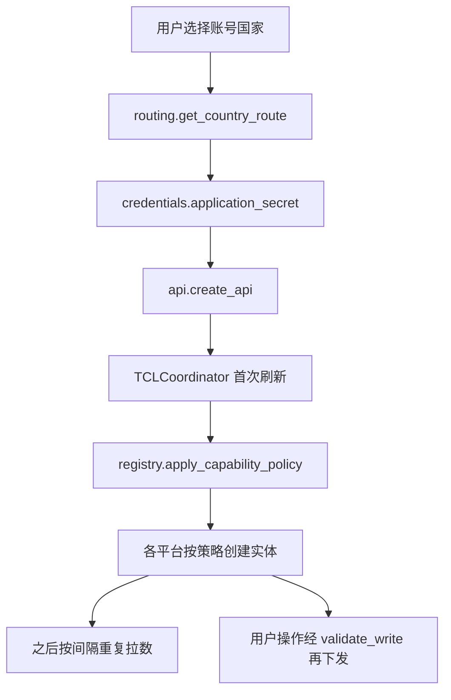
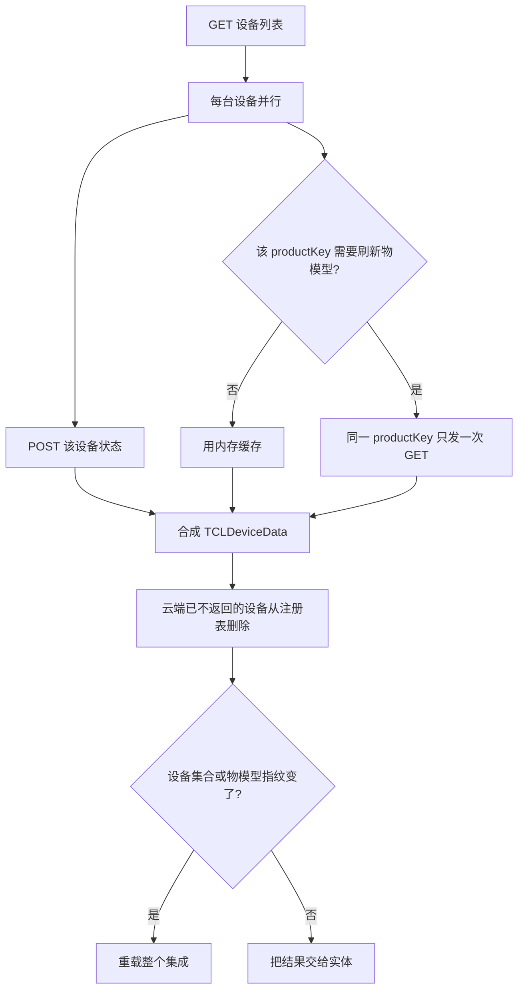
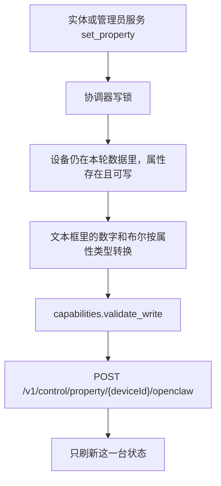

# 架构

集成跑在 Home Assistant 里。一次配置对应一个国家的 TCL 账号。国家决定走国内还是海外客户端；协调器按固定节奏拉设备、状态和物模型；能力策略决定哪些属性能变成实体、哪些值能写回去。

## 总流程

配置条目保存在 Home Assistant 里。里面有国家代码、访问令牌、刷新令牌和过期时间。应用密钥不在条目里，只从本机 `configuration.yaml` / `secrets.yaml` 读取。

## 1. 选国家

入口是 `config_flow.py` 的 `async_step_user`。用户选的是 TCL 账号注册国家，不是 Home Assistant 所在地。

`routing.py` 启动时读 `country_regions.csv`，得到 `CountryRoute`：国家代码、时区、账号中心区域、云区域。`auth_url` 和 `iot_url` 由账号中心区域决定：

| 账号中心区域 | 账号中心 | IoT 网关 |
| --- | --- | --- |
| CN | `cn.account.tcl.com` | `io.zx.tcljd.com` |
| SG | `sg.account.tcl.com` | `sgp-iot-api-prod.tcljd.com` |
| FR | `pa.account.tcl.com` | `eu-iot-api-prod.tcljd.com` |
| US | `us.account.tcl.com` | `us-iot-api-prod.tcljd.com` |
| BR | `br.account.tcl.com` | `br-iot-api-prod.tcljd.com` |

同一个国家只能有一条配置。国家代码是唯一 ID：`tcl_smart_home_<国家代码>`。

选完国家后进入扫码。`config_flow.py` 再调一次 `create_api`，只用来取二维码和换令牌。二维码图片地址必须通过 `api_common.safe_qr_url`：同源 HTTPS、在域名白名单内、不能带账号密码。`frontend/qr-dialog.js` 只改对话框外观，按钮仍点 Home Assistant 原来的流程项。

扫码成功后，流程先拉一次设备列表，确认令牌可用，再把国家和令牌写入配置条目。

## 2. 建客户端

Home Assistant 加载条目时走 `__init__.py` 的 `async_setup_entry`：

1. 没有国家代码的旧条目视为 CN。
2. `get_country_route` 解析路由。国家表里没有该代码时，条目保持未就绪。
3. 轮询间隔低于 15 秒时，改回默认 30 秒。上限 300 秒。
4. `credentials.application_secret` 按国家取密钥。CN 默认用源码里的公开 `DOMESTIC_APP_SECRET`，`configuration.yaml` 的 `domestic_app_secret` 可以覆盖。其他国家用 `overseas_client_secret`。缺密钥则条目未就绪。
5. 关闭证书校验的旧条目会被改回开启。
6. 使用 Home Assistant 的 aiohttp 会话，`verify_ssl=True`。

`api.create_api` 只看国家代码：

- `CN` → `api_domestic.DomesticApi`
- 其他国家 → `api.OverseasApi`，并带上这条 `CountryRoute`

两个客户端都继承 `api_common.TCLCloudClient`。真正发出请求前，`_raw_request` 做这些检查：

- 只允许 `https`，主机必须在 `ALLOWED_HOSTS`，端口只能是 443
- `allow_redirects=False`，3xx 直接失败
- 同时最多 4 个请求
- 429、5xx 和连接失败会进入冷却，冷却时间逐次加长，最长约 15 分钟
- HTTP 401/403 在已登录请求上记成业务码 401，供后面刷新令牌

令牌将要过期时，客户端自己刷新。国内刷新把 `appSecret` 放在 URL 参数里，海外把 `clientSecret` 放在 URL 参数里。这是厂商接口的形状。刷新成功后，协调器把新令牌写回配置条目。

业务码只有 401、10020、10021，以及几句固定文案，才算令牌失效。消息里出现 “token” 两个字不会触发重试。

## 3. 协调器拉数

`coordinator.py` 的 `TCLCoordinator` 挂在 `entry.runtime_data` 上。首次刷新失败时：授权问题或连不上云，条目未就绪，平台不会加载。

每一轮 `_async_update_data`：

设备列表、状态、物模型的路径都带 `/openclaw`。物模型是 `GET /tsl/{productKey}/tsl/openclaw`。

物模型按 productKey 缓存。有属性的模型 15 分钟刷新一次；第一次失败得到的空模型 60 秒后再试。同一轮里多台设备共用一个 productKey 时，只发出一个请求。

单台状态失败时，保留上一轮状态，并把这台标成不可用。授权失败会中断整轮刷新。设备仍在云端列表里时，不会因为这一次状态失败就把它删掉。

设备 ID 集合或物模型指纹相对上一轮发生变化时，协调器异步重载整个配置条目，好让新设备出现、旧能力退出。第一次刷新不重载。

控制成功后只刷新这一台的状态，不重拉全部设备。这次状态刷新失败时，已经发出的控制仍然算成功。

## 4. 能力策略决定实体

平台不直接相信云端的“可写”标记。`capabilities.py` 和 `capability_profiles.json` 是发现实体和写入指令的同一套规则。

判断顺序：

1. 用设备的 `productKey` 找到审核过的产品。
2. 用属性 `identifier` 找到这条规则。
3. 比较云端属性和规则里保存的 schema（访问模式和数据类型）。不一致则整条属性关闭。
4. 规则里的 `tier`、`writable`、`composite`、`actions` 决定平台和能不能写。

`platform_for` 的结果：

| 条件 | 实体 |
| --- | --- |
| 只读布尔 | `binary_sensor` |
| 只读其他标量 | `sensor` |
| 可写布尔 | `switch` |
| 可写数值 | `number` |
| 可写枚举 | `select` |
| 规则带有明确动作 | 另加 `button`，传感器仍保留运行状态 |
| `composite` 有角色 | 不单独建实体，交给空调实体 |
| 未审核或 schema 变化 | 不建控制实体 |

空调要同时有电源、模式、目标温度三个 composite 角色，才建 `climate`。当前温度只认 `currentTemperature` 和 `indoorTemperature`。

每台云端设备都会有一个诊断用的“云端在线”二进制传感器，即使物模型还没适配。

`registry.apply_capability_policy` 在平台加载前运行。它按当前策略启用仍有效的主实体，并停用不再允许的旧实体。停用只改注册表的禁用原因，不删历史。云端列表里已经没有的设备，由 `remove_stale_devices` 删掉设备和实体。

各平台文件只做投影：`climate.py`、`switch.py`、`number.py`、`select.py`、`sensor.py`、`binary_sensor.py`、`button.py`。它们从协调器读 `TCLDeviceData`，写操作一律进 `coordinator.async_set_property`。

## 5. 写入

`validate_write` 会拒绝：未审核属性、只读属性、错误类型、枚举以外的值、超出最小/最大/步长的数。枚举编码保持字符串，不会把 `007` 收成整数 `7`。

管理员服务在 `__init__.py` 注册。调用必须带用户身份，并且是管理员。它找到拥有该 `deviceId` 的那条配置，再走上面的同一条写入路径。普通实体动作使用 Home Assistant 自己的实体权限。

## 文件各自负责什么

| 文件 | 改这里的时机 |
| --- | --- |
| `config_flow.py` | 选国家、扫码、重新授权、轮询选项 |
| `routing.py`、`country_regions.csv` | 国家到区域、账号中心和 IoT 地址 |
| `credentials.py` | 本机密钥从哪项配置读取 |
| `api.py`、`api_domestic.py` | 某一侧的路径、请求头、刷新参数 |
| `api_common.py` | 两边共用的 TLS、白名单、限流、令牌错误判断 |
| `coordinator.py` | 拉数频率、缓存、控制后的刷新、令牌回写 |
| `capabilities.py`、`capability_profiles.json` | 哪些产品的哪些属性可以显示、可以写 |
| `model.py` | 物模型字段怎么解析、名称和图标 |
| `entity.py` 和各平台文件 | 一个 Home Assistant 实体怎么展示已允许的属性 |
| `registry.py` | 旧实体停用、已删除设备的清理 |
| `diagnostics.py` | 诊断里允许出现的字段 |
| `qr_frontend.py`、`frontend/qr-dialog.js` | 扫码对话框的展示 |

改写入规则时同时看 `capabilities.py` 和平台文件。只改平台、不改 `validate_write`，服务调用仍会按旧规则拒绝或放行。只改 `validate_write`、不改 `platform_for`，界面上的实体和实际能发的指令会不一致。
